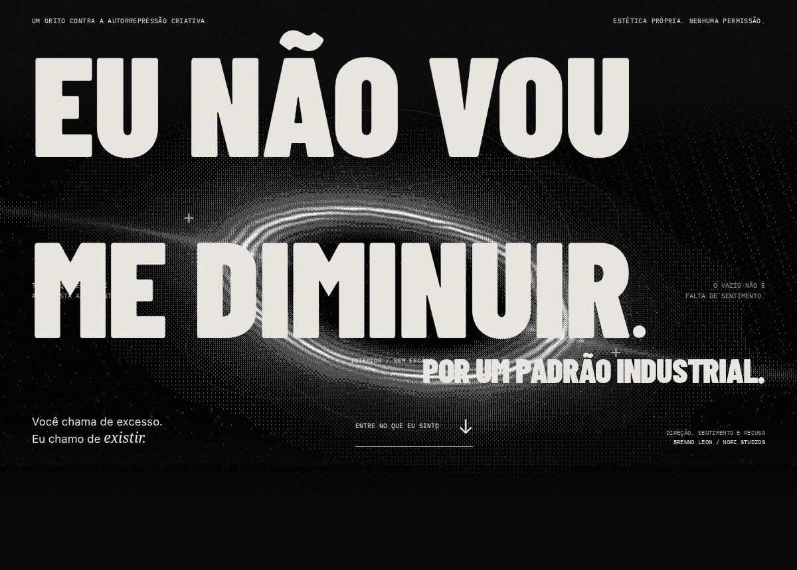

# Eu não vou me diminuir por um padrão industrial

Manifesto de **Brenno Leon de Souza Amaral | Nori Studios**.

[Abrir o site no GitHub Pages](https://anthophicous.github.io/eu-nao-vou-me-diminuir/)



Uma experiência editorial sobre o estresse de apagar a própria expressão para obedecer a um padrão da indústria. A leitura atravessa condicionamento, mutilação estética e vazio até chegar à recusa. O visitante participa da ruptura final.

## Rodar

Node.js 24 e npm.

```bash
npm ci
npm run dev
```

Abra o endereço mostrado pelo Vite. O projeto funciona como site estático, sem backend, chave de API ou variável de ambiente.

## Verificar

```bash
npm run lint
npm run typecheck
npm run build
npx playwright install chromium
npm test
```

Os 22 testes iniciam o preview da build na porta 4173. Verificam navegação, o gesto de segurar, cancelamento e repetição da ruptura, teclado, movimento reduzido, carimbos, transição de cor, ícones SVG, controles de áudio, fallback WebGL e responsividade em 360, 390, 834 e 1440 px. Os testes de áudio medem RMS e espectro na saída real do grafo Web Audio, incluindo volume zero e aba oculta.

O workflow `.github/workflows/ci.yml` repete lint, build e os testes de navegador. Não publica o site.

O workflow `.github/workflows/pages.yml` compila com a base do repositório e publica no GitHub Pages a cada push em `main`.

## Experiência

- **React e TypeScript**, compilados com Vite.
- **Lenis React** para leitura contínua e links de âncora.
- **Three.js com GLSL próprio** para o vazio gravitacional, posterização Bayer e transformação de OBEDEÇA em EXISTA.
- **CSS Animations** e timelines ligadas ao scroll para comprimir, deslocar e devolver peso ao texto. Navegadores sem timelines preservam a composição estática.
- **Tipografia cinética**: entradas por letra, expansão elástica, cortes laterais, saída dos títulos, palavras em rotação e ecos tipográficos. O preto cede ao vermelho durante a câmara de pressão.
- **Parede de recusa**: o visitante carimba frases sobre a composição. Os impactos também respondem com som quando a trilha está ligada.
- **Lucide React**: setas, navegação, controles de som e movimento usam ícones SVG.
- **Web Audio** opcional: drone com vozes de 110–330 Hz, harmônicos e ruído filtrado, pulsos industriais e impacto na ruptura. Ative em **Ativar som** ou **Ouça o que eu sinto**. O painel flutuante regula o volume de todas as vozes. O som inicia desligado; nenhuma gravação das músicas de referência é distribuída.
- Fontes e escultura servidas localmente. Nenhum rastreador, armazenamento de dados ou pedido de acesso ao microfone.

## Interação e acesso

No capítulo final, segure o botão por aproximadamente dois segundos para romper a contenção. Soltar antes cancela a pressão. Enter ativa a ruptura sem exigir um gesto cronometrado.

As animações começam ativadas, independentemente de `prefers-reduced-motion`, por decisão do autor. O controle de movimento permite pausa manual, e nesse estado a ruptura permanece disponível com um clique. O manifesto continua em HTML; a falha de WebGL apresenta uma imagem estática. As cenas param fora de tela e com a aba escondida.

## Organização

```text
src/
  App.tsx          Narrativa, navegação, som e ruptura
  App.css          Composição, scroll e responsividade
  index.css        Fontes, tokens e base acessível
  content.ts       Capítulos e declarações
  Stage.tsx        Ciclo das cenas e fallback
  shaders.ts       Campos procedurais e morfismo
  KineticText.tsx  Letras animadas com alternativa legível
  ManifestoMotion.tsx  Câmara de pressão, palavras e carimbos
  Motion.css       Coreografia e transições de cor
  audio.ts         Síntese e roteamento de todas as vozes
  useAtmosphere.ts Controles, volume e ciclo do áudio
public/
  art/             Escultura e documentação de origem
  fonts/           Fontes e licenças OFL
tests/             Comportamento, motion e medição real do áudio
CONCEPT.md         Dramaturgia, referências e decisões
```

## Build e hospedagem

```bash
npm run build
npm run preview
```

`dist/` contém o site para hospedagem estática. Para GitHub Pages em um subcaminho, informe a base ao compilar:

```bash
npm run build -- --base=/nome-do-repositorio/
```

A imagem da escultura usa `import.meta.env.BASE_URL`; o Vite ajusta as fontes e os assets da build. Na hospedagem definitiva, use a URL absoluta do domínio em `og:image` para a prévia social. Um repositório GitHub para o código não exige hospedagem no GitHub Pages.

## Créditos e referências

Direção e sentimento: Brenno Leon de Souza Amaral | Nori Studios. A redação e os shaders foram desenvolvidos para este manifesto a partir do briefing do autor.

Escultura **Laocoön**, artista italiano não identificado, séculos XVI–XVII, Princeton University Art Museum. Fonte e política de acesso em [public/art/SOURCES.md](public/art/SOURCES.md). Barlow Condensed e IBM Plex Mono sob SIL Open Font License, com os respectivos textos em `public/fonts/`.

**Cálice**, de Chico Buarque e Gilberto Gil, e **Apesar de Você**, de Chico Buarque, orientaram o estudo emocional por indicação do autor. O site não reproduz letras ou gravações. Contexto, fontes e interpretação em [CONCEPT.md](CONCEPT.md).

As referências visuais enviadas pelo autor não são redistribuídas. Este repositório não concede licença geral para o manifesto ou sua identidade visual; os materiais de terceiros conservam seus próprios termos.
